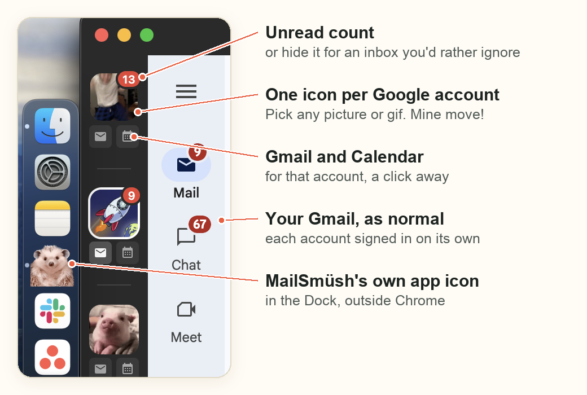

# MailSmüsh

<p align="center"></p>

A Mac app that keeps my three Gmail inboxes and Google Calendars in one place, as a desktop app of its own, outside Chrome.

<p align="center"></p>

Each account gets its own icon in the sidebar. The gifs are mine, for my personal, AIM and FarmKind accounts: you pick your own when you set it up, and you can swap the hedgehog for an app icon of your own too.

## What it does

- **One window for all your Google accounts:** a sidebar with an icon for each account, and a click to switch. Each account has its Gmail and its Calendar.
- **Its own app, outside your browser:** its own window and Dock icon (the hedgehog), so your email isn't one tab among dozens.
- **Unread counts** on each account's icon. You can hide them for an account you'd rather not be nudged by.
- **Each account stays signed in on its own**, so there's no switching Google accounts back and forth.
- **Email links from other apps** (the "mailto:" kind) open a compose window in the account you choose, if you make MailSmüsh your default email app.
- **Fingerprint sign-in:** when Google asks you to sign in again, touch the fingerprint sensor and it fills in your password. This is optional: it keeps your Google passwords in your Mac's keychain, unlocked with Touch ID.

## Get it

Mac only. The easiest way is to let Claude Code do it: paste this into Claude Code (the Code tab of the Claude desktop app).

```
Set up MailSmüsh for me: clone https://github.com/Aidan-Alexander/mailsmush to ~/MailSmush-source (or git pull there if it's already there), then follow SETUP.md in that folder.
```

Claude checks your Mac has what it needs, asks which Google accounts you want, which picture or gif to use for each and whether to keep the hedgehog app icon, then builds the app and puts it in your Applications folder. It takes about 10 minutes, most of it waiting. Then you open MailSmüsh and sign in to each account once.

To change it later, ask Claude Code, for example "add a fourth account to MailSmüsh" or "use this gif for my work account in MailSmüsh". To update it, paste the line again: your accounts, pictures and app icon are kept.

## For developers

It's an Electron app.
- `npm install`, then `npm start` runs it from source.
- `bash build-local.sh` builds it and installs it in /Applications. Add `--default-mail-app` to also make it the app that opens email links.
- Your accounts live in `renderer/accounts.js`, which stays out of git. Copy `renderer/accounts.example.js` to make one: it explains each setting.
- For your own app icon, put a square PNG at `images/custom-icon.png` (also out of git). The build turns it into the app icon.

## Credits

The hedgehog and the gifs came from around the internet. Built with Claude Code.

## Licence

[MIT](LICENSE)
